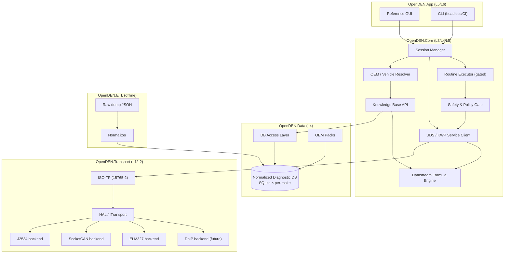
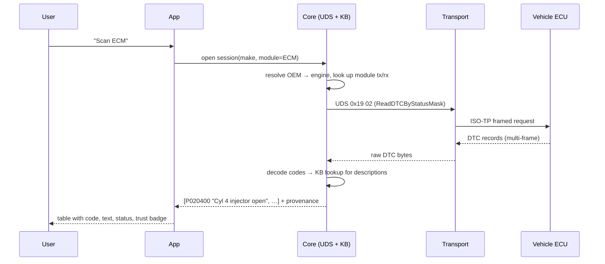
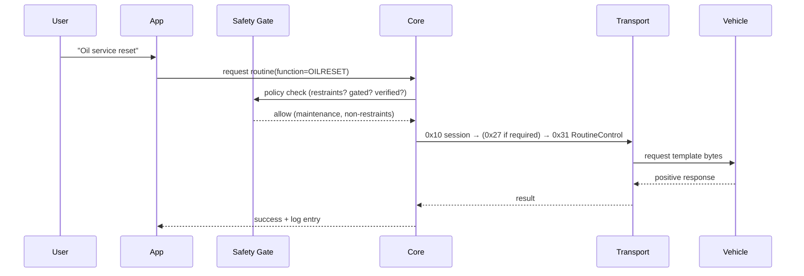

# 01 — System Architecture

## 1. Layered view

OpenDEN is a classic layered diagnostic stack. Data flows up (bytes → decoded values) and commands flow down (user intent → wire bytes). Each layer has one job and a stable interface to the layer above.

```
┌──────────────────────────────────────────────────────────────────────┐
│  L6  Presentation         Reference GUI  ·  CLI  ·  (future) web UI    │
├──────────────────────────────────────────────────────────────────────┤
│  L5  Application / Workflow                                            │
│      session orchestration · scan-all · guided routines · logging      │
├──────────────────────────────────────────────────────────────────────┤
│  L4  Knowledge / Data Access                                           │
│      OEM resolver · module map · DTC & datastream lookup · routines    │
│      ── reads ──►  Normalized Diagnostic DB  (SQLite, per make)        │
├──────────────────────────────────────────────────────────────────────┤
│  L3  Diagnostic Services  (UDS ISO 14229 / KWP2000 ISO 14230)          │
│      session control · read DTC · read data by ID · routine control    │
│      · security access (gated) · the datastream formula engine         │
├──────────────────────────────────────────────────────────────────────┤
│  L2  Transport / Session   (ISO-TP, ISO 15765-2)                       │
│      segmentation · flow control · addressing · DoIP (ISO 13400)       │
├──────────────────────────────────────────────────────────────────────┤
│  L1  Hardware Abstraction Layer (HAL)                                  │
│      J2534 PassThru · SocketCAN · ELM327 · (future) DoIP/Ethernet      │
├──────────────────────────────────────────────────────────────────────┤
│  L0  Interface hardware                                                │
│      Tactrix/Openport · MongoosePro · CAN-FD USB · ELM327 · OBX        │
└──────────────────────────────────────────────────────────────────────┘
```

The existing `/src/PassThru` C# is L1 (and part of L2): a complete SAE J2534 `IJ2534` / `IJ2534Extended` wrapper, a device finder, and an ELM327 transport. That's the bottom of the stack already in hand.

## 2. Component map



## 3. The modules (build targets)

| Component | Layer | Responsibility | Language (proposed) |
|---|---|---|---|
| `OpenDEN.Transport` | L1/L2 | HAL + ISO-TP. Wraps the existing J2534/ELM327 code behind one `ITransport`. | C# (existing) |
| `OpenDEN.Core` | L3–L5 | UDS/KWP client, session mgmt, formula engine, routine executor, safety gate, KB API. | C# (.NET) |
| `OpenDEN.Data` | L4 | DB access, schema versioning, pack loading/merging. | C# |
| `OpenDEN.ETL` | offline | Raw dump → normalized SQLite. Reproducible, hashed. | Python |
| `OpenDEN.App` | L5/L6 | Reference GUI + CLI. | C# (GUI) / C# (CLI) |
| **Packs** | data | Per-OEM DB + manifest, versioned and signed. | SQLite + TOML/JSON |

### Why C# for the engine

The transport layer is already C# and is high quality (`IJ2534Extended`, full ioctl surface, periodic msgs, flow control). It targets Windows J2534 drivers natively — which is where most professional PassThru hardware lives — and runs cross-platform on .NET for the SocketCAN/ELM paths. The ETL stays Python because the raw-dump parsing, big-number mask handling, and formula work are far faster to iterate in Python, and ingestion is an offline concern decoupled by the SQLite file. This split is recorded in [ADR-0003](adr/0003-transport-hal.md).

> Contributors who prefer a pure-Python or Rust client can build one against the *same* SQLite schema and ISO-TP contract — the data/engine separation makes alternative engines first-class, not forks. [OpenVehicleDiag](https://awesome.ecosyste.ms/projects/github.com%2Frnd-ash%2Fopenvehiclediag) (Rust) and [udsoncan](https://awesome.ecosyste.ms/projects/github.com%2Fpylessard%2Fpython-udsoncan) (Python) are prior art worth reading.

## 4. Data flow — two canonical paths

### 4.1 Read a fault code (read-only, works on an ELM327)



### 4.2 Run a service routine (gated, wants a real device)



## 5. Deployment shapes

- **Workshop desktop (primary):** Windows/.NET GUI + J2534 tablet-grade interface. Full feature set.
- **Linux/SocketCAN bench:** CLI or GUI on Linux with a USB-CAN adapter. Great for development and CI.
- **Enthusiast ELM327:** read-only mode on a cheap dongle. No routines, no multi-frame write.
- **Headless/CI:** the CLI drives a SocketCAN **virtual** bus (`vcan0`) against recorded or simulated ECUs for regression tests. See [09](09-contributing.md).

## 6. Cross-cutting concerns

| Concern | Where it lives | Notes |
|---|---|---|
| Logging / session capture | Core (L5) | Every bus exchange is capturable to a replayable trace. Feeds verification (see [03](03-provenance-trust-coverage.md)). |
| Safety & policy | `SAFE` gate (L3 boundary) | Single choke point; nothing reaches the bus as a write/routine without passing it. |
| Schema versioning | Data layer | DB carries a schema version; engine refuses mismatched packs. |
| Localization | KB | DTC/label text is multi-language in source; schema keeps text refs separable. |
| Telemetry | — | None. Local-first by principle. |

---

Previous: [00 — Overview](00-overview.md) · Next: [02 — Data Model](02-data-model.md)
