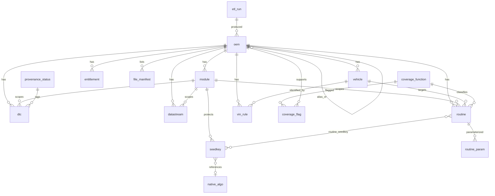

# 02 — Data Model

This is the canonical reference for the normalized diagnostic database. It is derived from, and must stay in sync with, the live schema in [`/Data/Sqlite`](../Data/Sqlite). Every field below exists in those files today.

## 1. Shape and scope

- **One SQLite file per make**, named `diag_<MAKE>.sqlite` (e.g. `diag_CHERY.sqlite`). This keeps packs independently shippable and versionable ([06](06-oem-pack-model.md)), and keeps a single corrupt/bad pack from poisoning the set.
- **17 tables + 1 view.** Reference/enum tables, entity tables, and content tables.
- Row counts are real. Across the 15 shipped make files: **177,279 DTCs, 128,306 datastreams, 470 modules, 646 routines, 36 OEM entries.**

### Per-make breakdown

| Make file | OEM | Veh | Modules | DTCs | Datastreams | Routines |
|---|--:|--:|--:|--:|--:|--:|
| `diag_BAICMOTOR` | 5 | 5 | 65 | 13,703 | 11,555 | 0 |
| `diag_BYD` | 2 | 2 | 26 | 15,710 | 6,804 | 0 |
| `diag_CHANGAN` | 1 | 1 | 13 | 25,300 | 10,675 | 0 |
| `diag_CHERY` | 8 | 8 | 105 | 19,429 | 11,089 | 91 |
| `diag_DFFS` | 1 | 1 | 13 | 13,082 | 4,616 | 0 |
| `diag_DFFX` | 1 | 1 | 13 | 11,002 | 3,090 | 0 |
| `diag_DFXK` | 2 | 2 | 26 | 16,655 | 1,899 | 0 |
| `diag_GEELY` | 5 | 5 | 65 | 21,316 | 9,590 | 91 |
| `diag_GREATWALL` | 2 | 2 | 26 | 15,750 | 9,773 | 0 |
| `diag_LYNKCO` | 1 | 1 | 13 | 155 | 9,261 | 0 |
| `diag_MAHINDRA` | 1 | 1 | 13 | 0 | 0 | 0 |
| `diag_SAICMAXUS` | 1 | 1 | 14 | 74 | 19,070 | 0 |
| `diag_SAICMG` | 2 | 2 | 26 | 14,519 | 27,663 | 0 |
| `diag_SGMW` | 3 | 3 | 39 | 10,584 | 3,221 | 0 |
| `diag_SSANGYONG` | 1 | 1 | 13 | 0 | 0 | 464 |

Uneven coverage is expected and *honest* — the provenance model ([03](03-provenance-trust-coverage.md)) records why a cell is empty (not extracted yet vs. blocked vs. genuinely none).

## 2. Entity-relationship diagram



## 3. Reference / enum tables

### `provenance_status`
The trust vocabulary. Six statuses; see [03](03-provenance-trust-coverage.md) for full semantics.

| status | populate_now | meaning |
|---|--:|---|
| `NOW-EXTRACTED` | 1 | Fully parsed, in hand. |
| `NOW-STRUCTURE-ONLY` | 1 | Framed/classified; payload semantics not decoded → metadata/slot only. |
| `BLOCKED-CALCSCRIPT` | 0 | Needs the vendor's blocked script interpreter + string-pool codec (absent from dump). |
| `BLOCKED-RPC` | 0 | Computed off-box via a vendor online/RPC call. |
| `GATED-LEGAL/IP` | 1 | Present but must not be lifted (vendor binaries, signing material). |
| `UNVERIFIED` | 0 | Not confirmed this pass. |

### `coverage_function`
The 79 canonical function classes, grouped `MAINTENANCE` (68), `SPECIAL` (11). `function_id` is the source tool's numeric key. Examples: `OILRESET`(6), `IMMO`(15), `ODOMETER`(31), `EEPROM`(40), `ECUFLASHING`, `CODING`, `ADAPTATION`. This is the controlled vocabulary the UI groups routines under, and the hook the Safety Gate keys off ([07](07-safety-security-legal.md)).

## 4. Entity tables

### `oem` — the make/brand registry and **engine resolver**
The clever bit of the model. A row is either an **ENGINE** (a real diagnostic engine with its own logic), an **ALIAS** (a badge that reuses another engine via `alias_of`), or a **UTIL**. The `v_oem_resolved` view flattens aliases to their engine.

Key fields: `softcode_adr` (natural upsert key, e.g. `AD900_CarSW_CHERY`), `canonical_name`, `badge`, `role` (`ENGINE|ALIAS|UTIL`), `alias_of`, `region`, `version`/`version_diag`, `launch_engine_so` (filename only — the binary itself is never stored), `engine_tier` (`A` full-symbol / `B` stripped / `C` stub), `transports` (JSON array), `container_family`.

> Example: `diag_CHERY` has one `ENGINE` (CHERY) and seven `ALIAS` rows — CHERYEV, COWIN, EXEED, JETOUR, KARRY, RELY, RIICH — all `alias_of` the Chery engine. One engine, many badges. The UI resolves the badge the user picked to the engine that actually answers.

### `vehicle`
Per-badge vehicle entries scoped to an OEM. `badge`, `model` (often NULL until unblocked), `year_from`/`year_to`, `market_region`. Vehicle-granular model/year resolution is a known gap — it lands when VIN rules decode (see `vin_rule`).

### `module` — the ECU map
The addressable control units. `acronym` (controlled: ECM, TCM, ABS, SRS, BCM, BMS, EPS, IC, HVAC, ADAS, IMMO, INFORMA, LED, ALL_SYSTEM), `name_full`, `tx_id`/`rx_id` (CAN request/response IDs, hex — **NULL until decoded**), `is_restraints` (**1 ⇒ the Safety Gate treats it as airbag/SRS**), `supported_services` (JSON array of UDS service names).

> `is_restraints` is the single most important safety flag in the schema. Today only `SRS` carries it; the contributor rule is that **any** restraint controller (SRS/RCM/ACU/OCM/pretensioner/FSRS) must set it. See [07](07-safety-security-legal.md).

### `entitlement`
Licensing metadata lifted from the source tool's bean (PII redacted). `free_type` (2=paid/1=free), `function_mask`/`large_function_mask` (decimal bignum text — SQLite has no uint64). Useful for understanding which functions the source tool *enabled* per make; not used to gate OpenDEN itself.

### `file_manifest`
Inventory of the source containers: `path`, `md5`, `package_type`, `version`, `container_family`, build/source timestamps, `current_function_mask`. **Filenames and hashes only — no file contents.** This is the chain-of-custody record for ingestion, not a payload store.

## 5. Content tables

### `dtc` — fault codes (177k rows, the workhorse)
`code` (SAE J2012 decoded, e.g. `P020400`, `U0527`, `B100318`, or raw numeric like `9219`), `description`, `read_service` (`19` UDS / `18` KWP), `clear_service` (`14`), `status_mask_template`, `module_id` (often NULL — code is make-global until module-resolved), `content_hash`. Mostly `NOW-EXTRACTED` and ready to use.

### `datastream` — live-data parameters (128k rows)
`pid_or_did` (the identifier; may be a raw PID/DID or an `FML:<hash>` formula handle), `label`, `unit`, and **`formula`** — the scaling expression. The formula is the source tool's little expression language; decoding it is the job of the **Formula Engine** ([05](05-protocol-services.md)). Example formula:
```
int y;BYTE x1,x2;y=x1*125/255.0+x2*125;
```
Rows where the raw value needs the vendor's blocked interpreter are tagged `BLOCKED-CALCSCRIPT`; rows with a self-contained formula are `NOW-EXTRACTED`.

### `routine` — service procedures (646 rows)
The bidirectional heart. `function_id` (→ `coverage_function`), `service` (`RoutineControl`/`IOControlByIdentifier`/`DiagnosticSessionControl`/…), `sid` (`31`), `sub` (`01`), `rid_or_did` (`B114`), and the wire templates: **`request_template_hex`** (bytes on the wire — NULL when `BLOCKED-CALCSCRIPT`), `expected_response_hex`, `response_match_mask`. Plus `frame_source` and `verified` — the verification spine ([03](03-provenance-trust-coverage.md)):

`frame_source ∈ { CalcScriptPendingLibStd, ExtractedFromExternalData, StandardUds, PublicServiceDoc, HandCurated, VehicleTested }`

> A routine only reaches the user as *executable* when it has real template bytes **and** a trusted `frame_source` **and** passes the Safety Gate. Everything else is reference metadata. The 646 routines present today (Chery 91, Geely 91, SsangYong 464) are `ExtractedFromExternalData`, `verified=0` — i.e. *catalogued, not yet trusted to fire*.

### `routine_param`
Decodes a routine's request into fields: `seq`, `byte_offset`, `byte_len`, `kind` (`const|seed-echo|vin|user-input|counter`), `default_hex`. Lets the engine build a request from user input instead of shipping a fixed blob.

### `vin_rule`
VIN decoding: `wmi`, `vin_pattern`, `decode_source` (`vinMenu|RES-cfg|online-RPC|AUTOVIN`). The path to automatic model/year/engine resolution. Mostly structure-only today.

## 6. Security-adjacent tables (metadata only — read [07](07-safety-security-legal.md))

Two tables exist to **model** security access so the engine knows when a routine needs an unlock and can refuse cleanly. They are deliberately near-empty: no cryptographic material is shipped.

### `seedkey`
Structural description of a SecurityAccess relationship: `access_level` (`01`/`03`/`05`…), `seed_len`, `key_len`, `algo_family` (a *label*, e.g. `LFSR`/`TEA`/`RPC`), `impl_location` (`local-so|rpc|dat-script|UNVERIFIED`), `const_params` (JSON **structural** params only), `native_algo_ref` (a soft name reference). Default provenance `UNVERIFIED`. There is **no key computation here** — this table says *that* a lock exists and what shape it is, not how to open it.

### `native_algo`
A registry of algorithm *names/slots* found in the source (`export_name`, `ordinal`, `vault`, `status ∈ {REAL, PENDING-libStd, SERVER-GATED}`, `self_test_gated`). Every row ships as `PENDING-libStd` / gated — i.e. a named slot with no implementation. It exists so the engine can say "this needs an algorithm we don't ship" rather than silently failing. See [ADR-0004](adr/0004-safety-gating.md).

### `routine_seedkey`
Join table: which seed/key unlock a routine needs first (`unlock-before|unlock-during|optional`).

## 7. ETL / audit tables

- **`etl_run`** — one row per ingestion pass: `started_utc`, `dump_sync_id`, `tool_version`, `notes`. Every content row carries `etl_run_id` so you can trace any datum to the exact run that produced it.
- **`content_hash`** columns — on every content table, for dedup and change detection across runs ([08](08-ingestion-pipeline.md)).

## 8. The resolver view

```sql
CREATE VIEW v_oem_resolved AS
SELECT a.oem_id, a.badge, a.role,
       COALESCE(e.canonical_name, a.canonical_name) AS engine_name,
       COALESCE(e.oem_id, a.oem_id)                 AS engine_oem_id
FROM oem a LEFT JOIN oem e ON a.alias_of = e.oem_id;
```
The engine always queries through this view so alias badges transparently resolve to the engine that actually holds the logic.

## 9. Conventions contributors must follow

1. **Hex is uppercase, no `0x`** in `*_hex` and `tx_id`/`rx_id` columns (`7E0`, not `0x7e0`).
2. **Bignums are decimal text** (`function_mask`), never integers — SQLite can't hold uint64 safely.
3. **Never store a value more confidently than it is.** Pick the right `provenance`/`frame_source`; `verified=1` requires a logged bus trace ([03](03-provenance-trust-coverage.md)).
4. **No binaries, no keys.** `launch_engine_so`/`file_manifest.path` are filenames; `seedkey`/`native_algo` are structural slots. If you're about to paste a `.so`, a `.p12`, or a working key routine — stop and read [07](07-safety-security-legal.md).
5. **One make per file.** New make ⇒ new `diag_<MAKE>.sqlite` + pack manifest ([06](06-oem-pack-model.md)).

---

Previous: [01 — Architecture](01-architecture.md) · Next: [03 — Provenance, Trust & Coverage](03-provenance-trust-coverage.md)
