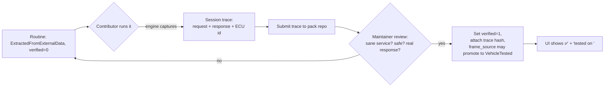

# 03 — Provenance, Trust & Coverage

The single idea that makes this project trustworthy: **the database never pretends to know more than it does.** Every datum records where it came from and how much to trust it, and the engine and UI surface that honestly. A guessed PID scaling must never render like a measured one; a catalogued routine must never fire like a verified one.

## 1. The provenance vocabulary

Defined in `provenance_status`. `populate_now` says whether the datum is real/usable now (1) or a slot awaiting decode (0).

| status | usable now | what it means for the engine |
|---|:--:|---|
| `NOW-EXTRACTED` | ✅ | Fully parsed, in hand. Safe to read/display. |
| `NOW-STRUCTURE-ONLY` | ⚠️ | We know it *exists* and its shape, not its payload semantics. Show as metadata; don't decode. |
| `BLOCKED-CALCSCRIPT` | ❌ | Needs the vendor's blocked script interpreter + string-pool codec (not in the dump). Display as "locked — needs decode". |
| `BLOCKED-RPC` | ❌ | The source tool computed this off-box via an online/RPC call. Not reproducible offline. |
| `GATED-LEGAL/IP` | 🔒 | Present in source but must not be lifted (vendor binaries, signing material). Engine references it, never ships it. |
| `UNVERIFIED` | ❌ | Not confirmed this pass. Treat as a lead, not a fact. |

## 2. Routine trust spine: `frame_source` × `verified`

A routine has wire bytes, but *where did those bytes come from* and *has anyone proven they work*? Two independent axes.

### `frame_source` — origin of the request template
Ordered roughly from "trust the standard" to "trust a human proved it":

| frame_source | meaning | default trust |
|---|---|---|
| `StandardUds` | Pure ISO 14229 service, no OEM specifics. | High |
| `PublicServiceDoc` | From a public service manual / TSB. | High |
| `VehicleTested` | Captured/confirmed on a real vehicle with a logged trace. | Highest |
| `HandCurated` | A contributor built it by hand from knowledge. | Medium — needs a tester |
| `ExtractedFromExternalData` | Pulled from the source dump's data (what most rows are today). | Medium — catalogued, unproven |
| `CalcScriptPendingLibStd` | Template depends on the vendor's blocked interpreter; bytes are NULL. | None — not executable |

### `verified` — has it been proven on a bus?
`0` = no logged confirmation. `1` = a session trace exists showing the request + an accepted response on a real or simulated ECU. **`verified=1` is never set by ingestion** — only by a human submitting a trace through the verification flow (§4).

### The firing rule

```
executable  ⇔  request_template_hex IS NOT NULL
            ∧  frame_source ∈ { StandardUds, PublicServiceDoc, VehicleTested,
                                 HandCurated(verified=1), ExtractedFromExternalData(verified=1) }
            ∧  Safety Gate passes  (see 07)
```

Everything else is **reference-only**: shown in the UI greyed out with its status, never sent to the bus. Today's 646 routines are `ExtractedFromExternalData, verified=0` → catalogued, not yet firing. Turning them green is exactly the community's job.

## 3. Coverage tracking

Two tables answer "what can this make do?" *without* lying about what we've proven.

- **`coverage_function`** — the 79-entry controlled vocabulary (OILRESET, EPB, DPF, BMS, …).
- **`coverage_flag`** — per `(oem, function)`: `is_supported`, `customize_group`, `source` (`Diag.ini | iniSystem | function_mask`). This is what the *source tool claimed* to support.

The UI shows a coverage matrix with a crucial distinction:

```
┌─ Function ─────┬─ Claimed ─┬─ We can drive it ─┐
│ OILRESET       │    ✅     │  ✅ (2 verified)  │
│ EPB            │    ✅     │  ⚠️ catalogued     │
│ DPF            │    ✅     │  ⚠️ catalogued     │
│ IMMO           │    ✅     │  🔒 gated/off      │
│ ODOMETER       │    ✅     │  🔒 not shipped    │
└────────────────┴───────────┴───────────────────┘
```

"Claimed" comes from `coverage_flag`. "We can drive it" is computed live from the firing rule + Safety Gate. The gap between the two columns is the project's to-do list, visible to everyone.

## 4. The verification flow (how a routine goes green)



Rules:
- A trace is a replayable log of the actual bus exchange (the Transport layer captures these natively, [04](04-transport-hal.md)).
- `verified=1` requires the trace to be attached and its `content_hash` recorded against the routine's `etl_run`/source_ref.
- Restraints-module and gated-function routines **cannot** be promoted through the normal flow — see [07](07-safety-security-legal.md).
- One positive trace promotes a routine to "tested"; the UI still shows *which* vehicle/VIN-pattern it was tested on, because coverage is model-specific.

## 5. Why empty cells are a feature

`diag_MAHINDRA` and `diag_SSANGYONG` have 0 DTCs; `diag_LYNKCO` has 155 DTCs but 9,261 datastreams; `SSANGYONG` has 464 routines but no DTCs. That asymmetry is **recorded truth**, not failure — those are what the current ingestion pass actually resolved from each source family. The provenance model means a contributor can look at any gap and know whether it's:

- **not extracted yet** → run ETL again / find the source (`BLOCKED-*`),
- **structurally present but undecoded** (`NOW-STRUCTURE-ONLY`), or
- **genuinely none** for that make.

No guessing, no silent zero-fill. That is the whole point.

## 6. Contributor checklist for provenance

- [ ] Picked the *most conservative* `provenance` that's still true.
- [ ] Left `verified=0` unless you're attaching a real bus trace.
- [ ] Didn't promote `frame_source` beyond what you can defend.
- [ ] Recorded `source_ref` so the next person can retrace you.
- [ ] If it's a restraints or gated function — stopped and read [07](07-safety-security-legal.md).

---

Previous: [02 — Data Model](02-data-model.md) · Next: [04 — Transport & HAL](04-transport-hal.md)
