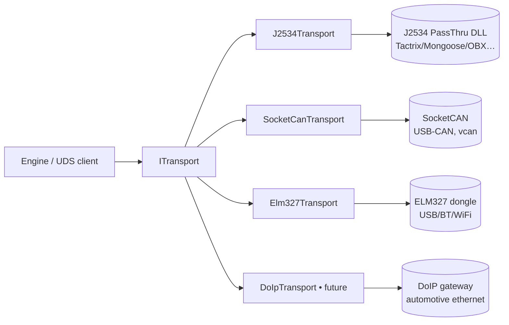
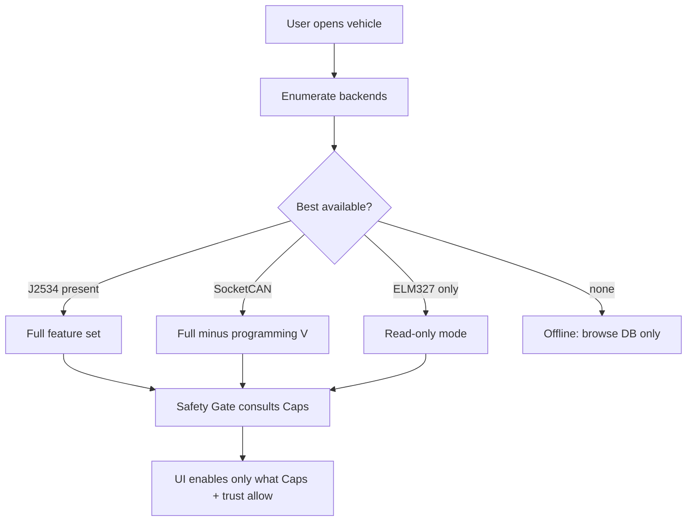

# 04 — Transport & Hardware Abstraction

This layer is the part already partly built: [`/src/PassThru`](../src/PassThru) contains a full SAE J2534 wrapper and an ELM327 transport in C#. This document specifies the abstraction that sits over it so the engine never knows or cares what hardware is attached.

## 1. The one interface

Everything above L2 talks to a single `ITransport`. Backends implement it. The engine binds to the interface, picks a backend at runtime, and degrades features by backend capability — not by special-casing.

```csharp
public interface ITransport : IDisposable
{
    TransportCaps Capabilities { get; }          // what this backend can do
    void Open(ChannelConfig cfg);                // protocol, baud, flags
    void Close();

    // ISO-TP framed request/response (the 99% path)
    IsoTpResult Request(IsoTpRequest req, TimeSpan timeout);

    // Raw single frames (filters, broadcasts, non-ISO-TP)
    void Send(CanFrame frame);
    bool TryReceive(out CanFrame frame, TimeSpan timeout);

    // Filters / flow control
    int AddFilter(CanFilter filter);
    void RemoveFilter(int filterId);

    // Diagnostics about the link itself
    int ReadBatteryMillivolts();                 // where supported
    TraceHandle BeginTrace();                    // capture for verification (03)
}

[Flags]
public enum TransportCaps
{
    Read              = 1,      // read DTCs / data (ELM327 can do this)
    MultiFrameIsoTp   = 1 << 1, // segmented UDS (real devices)
    FlowControl       = 1 << 2,
    Periodic          = 1 << 3, // tester-present / periodic msgs
    ProgrammingVoltage= 1 << 4, // pin voltage (J2534)
    CanFd             = 1 << 5,
    DoIP              = 1 << 6, // ethernet / ISO 13400
    Trace             = 1 << 7  // native session capture
}
```

`Capabilities` is how the Safety Gate and UI know, e.g., that an ELM327 can read DTCs but must not be offered routine execution.

## 2. Backends



### 2.1 `J2534Transport` — primary, mostly built
Wraps the existing `IJ2534Extended` (`/src/PassThru/J2534.cs`). That wrapper already exposes the full surface the HAL needs:

- `PassThruConnect` / `Disconnect` / `ReadMsgs` / `WriteMsgs`
- `PassThruStartMsgFilter` / `StopMsgFilter` (flow-control filters for ISO-TP)
- `PassThruStartPeriodicMsg` / `StopPeriodicMsg` (tester-present)
- `PassThruSetProgrammingVoltage`, `ReadBatteryVoltage`
- `FiveBaudInit` / `FastInit` (legacy KWP wake-up)
- `ClearTxBuffer` / `ClearRxBuffer`, config get/set via `Ioctl`

Device discovery is handled by `/src/PassThru/J2534DeviceFinder.cs` (enumerates installed PassThru DLLs from the Windows registry). `TransportCaps` for J2534 = everything except (usually) DoIP.

> There is already a `RemotePassThru` relay hook noted in the interface comments — an `IJ2534` implementation that answers for a *far-end* device. That cleanly enables a networked/bench setup (engine on a laptop, interface on the car) without the engine knowing. Keep that seam.

### 2.2 `SocketCanTransport` — Linux/dev/CI
Native CAN(-FD) on Linux via SocketCAN. Pairs with `can-isotp` (in-kernel ISO-TP) or a userspace ISO-TP. This is the backend for **CI against `vcan0`** and for cheap USB-CAN benches. `TransportCaps` = Read | MultiFrameIsoTp | FlowControl | Periodic | CanFd | Trace.

### 2.3 `Elm327Transport` — cheap, read-only
Wraps the existing `ELM327Transport` (`/src/PassThru/ELM327.cs`). ELM327 clones are slow, flaky on multi-frame, and vary wildly in firmware honesty, so:

- Capabilities are **Read only** by default. The engine offers DTC read, clear (with confirmation), and single-frame live data.
- Multi-frame ISO-TP is attempted only on firmware that advertises it, and routine execution is **disabled** on this backend.
- This keeps the "$30 dongle for owners" promise without pretending it's a bench tool.

### 2.4 `DoIpTransport` — future, for new EV/zonal cars
Newer Chinese EVs (and zonal E/E architectures generally) move diagnostics onto automotive ethernet with **DoIP (ISO 13400)**. Same UDS services ride on top, so this is a new L1/L2 backend under the *same* `ITransport`, and the engine above L2 is unchanged. Scheduled post-1.0 ([10](10-roadmap.md)).

## 3. Protocol stack inside the transport

```
UDS / KWP request  (from L3)
        │
   ISO-TP (ISO 15765-2)      ← segmentation, flow control, STmin/BS
        │
   addressing: 11-bit / 29-bit CAN  ·  physical vs functional
        │
   CAN 2.0 / CAN-FD frames   (backend)   or   DoIP (ethernet)
```

Addressing comes from the data model: `module.tx_id` / `module.rx_id` give the request/response CAN IDs (hex, e.g. `7E0`/`7E8`), and functional broadcast (`7DF`) is used for "scan all / who's there". These IDs are `NULL` in many packs until decoded — the engine falls back to the standard 11-bit OBD range probe when they're missing.

## 4. Channel configuration

```csharp
public sealed record ChannelConfig(
    ProtocolId Protocol,     // ISO15765, CAN, ISO14230(KWP), J1850VPW, ISO9141
    int BaudRate,            // 500000 typical; 250000 some; CAN-FD data phase separate
    bool Extended29Bit,
    IsoTpAddressing Addressing,  // physical / functional, normal / extended / mixed
    int? FlowControlStMinMs,
    int? FlowControlBlockSize);
```

The `ProtocolID` and `BaudRate` enums already exist in `J2534.cs` and map straight through.

## 5. Tracing — the bridge to verification

`BeginTrace()` returns a handle that records every frame in/out with timestamps. A trace is:

- the evidence that promotes a routine to `verified=1` ([03](03-provenance-trust-coverage.md)),
- a replay source for CI (feed a recorded trace to a simulated ECU),
- the user's "what did it actually do" log.

Trace format: newline-delimited JSON of `{t, dir, id, data_hex, protocol}` — trivially diffable, replayable, and safe to attach to a PR (strip VIN/PII first; the tooling does this).

## 6. Backend selection & capability degradation



Offline mode matters: with no interface attached, the engine still opens the packs and lets you *browse* every DTC, datastream and routine. Good for study, estimating a job, or contributing data from the couch.

---

Previous: [03 — Provenance](03-provenance-trust-coverage.md) · Next: [05 — Protocol & Service Layer](05-protocol-services.md)
