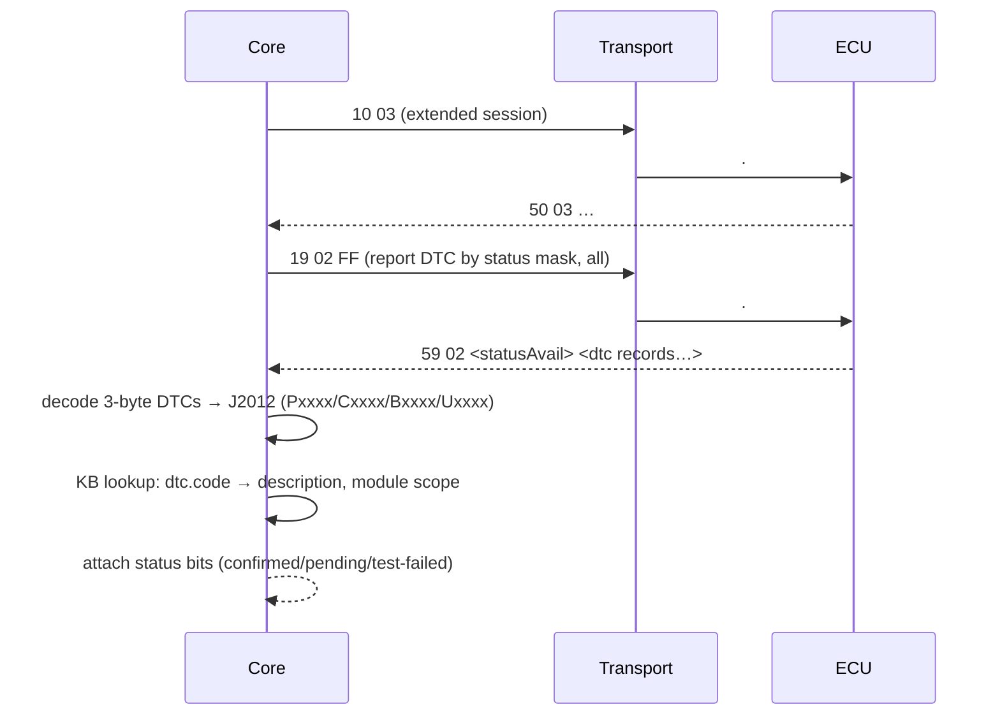
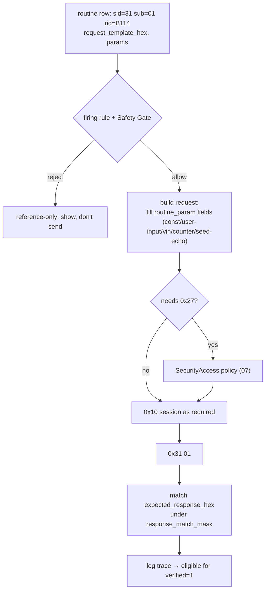

# 05 — Protocol & Service Layer

Layer 3: the diagnostic services. This is where the engine turns "read the ECM's faults" into `0x19 0x02 …` and turns a raw datastream response into "coolant temp = 87 °C". It targets **UDS (ISO 14229)** first, with **KWP2000 (ISO 14230)** for older modules.

## 1. Service model

The engine implements the UDS services the data model actually references. Each maps to a `routine.service` name and a `sid`.

| SID | Service | Used for | Risk |
|---|---|---|---|
| `0x10` | DiagnosticSessionControl | Enter default/extended/programming session | low |
| `0x11` | ECUReset | Reset a module (`ECURESET` function) | medium — confirm |
| `0x14` | ClearDiagnosticInformation | Clear DTCs | medium — confirm |
| `0x19` | ReadDTCInformation | Read faults (subfn `0x02` by status mask) | **read** |
| `0x22` | ReadDataByIdentifier | Live data by DID | **read** |
| `0x23` | ReadMemoryByAddress | Read memory | medium |
| `0x27` | SecurityAccess | Seed/key unlock | **gated** ([07](07-safety-security-legal.md)) |
| `0x28` | CommunicationControl | Silence/enable bus chatter | medium |
| `0x2E` | WriteDataByIdentifier | Write a DID (coding/adaptation) | **high — gated** |
| `0x2F` | InputOutputControlByIdentifier | Actuator tests | high — confirm |
| `0x31` | RoutineControl | Start/stop/result a routine | varies |
| `0x3E` | TesterPresent | Keep session alive | low |
| `0x85` | ControlDTCSetting | Suppress DTC logging during work | medium |

Legacy KWP (`read_service '18'`, `clear_service` equivalents) is supported for modules that predate UDS; the service client picks the dialect from `module.supported_services` / the DTC `read_service` field.

## 2. Reading DTCs (the everyday path)



DTC byte→text decoding is pure ISO/J2012 and lives in the engine. The *description* ("Cylinder 4 fuel injector control circuit open") comes from the `dtc` table. If a code isn't in the pack, the engine still shows the standard-decoded code and a generic J2012 description — honest partial coverage rather than a blank.

## 3. The datastream formula engine

`datastream.formula` holds the source tool's scaling expressions. They're a small C-like DSL. Examples straight from the data:

```c
// linear scale, two bytes
int y; BYTE x1,x2; y = x1*125/255.0 + x2*125;

// bitmask → enumerated string handle
string y; BYTE x; if (x&0x40) y='4dffffff00a6'; else y='4dffffff0492';

// switch on bits
string y; BYTE x1; switch((x1>>2)&0x01){ case 0x00: y='FE00000715D6'; break; default: y='FE00000715D7'; break; }
```

### 3.1 What the engine must implement

A **sandboxed evaluator** for this DSL. Grammar is small:

- typed temporaries: `int`, `BYTE`, `string`, `float`, `long`
- input bytes `x1..xN` bound from the response payload (and a single `x` alias)
- arithmetic, bitwise (`& | ^ >> <<`), comparison, `if/else`, `switch/case`
- assignment to `y` (the output), with a trailing `#<printf-format>` giving display formatting (`#%d`, `#%s`, `#%.2f`)
- string outputs that are **handles** into the string pool (e.g. `'4dffffff00a6'`) → resolved to localized text via the KB

### 3.2 Hard rules for the evaluator

1. **No host access.** It's a pure value transform: bytes in, scaled value out. No file/network/system calls. (It's parsing data of unknown origin — treat it like the untrusted input it is.)
2. **Bounded.** No unbounded loops; fixed instruction/time budget per evaluation.
3. **Total.** Any parse/eval error yields a *typed "undecodable"* result with the raw bytes preserved — never a crash, never a fabricated number.
4. **Provenance-aware.** A formula tagged `BLOCKED-CALCSCRIPT` (needs the vendor interpreter we don't have) is **not** evaluated; the UI shows raw bytes + "needs decode".

### 3.3 Reference evaluator shape

```
parse(formula) -> AST            # cache per formula hash
bind(AST, response_bytes) -> env # x1..xN, x
eval(AST, env) -> (value, fmt)   # pure, bounded
resolve(value, fmt, KB) -> Display # string-handle → localized text
```

The string-pool handles (`FE000007…`, `4dffffff…`) are references into the source's blocked string pool. Where that pool is undecoded, the engine shows the handle and marks the row `NOW-STRUCTURE-ONLY` — again, honest partial.

## 4. Running a routine (0x31 RoutineControl)

The engine builds a request from `routine` + `routine_param` rather than firing a fixed blob, so user inputs, counters, and seed-echoes slot in correctly.



`routine_param.kind` drives request construction:

| kind | engine behaviour |
|---|---|
| `const` | use `default_hex` verbatim |
| `user-input` | prompt (with units/range), validate, insert |
| `vin` | insert the vehicle VIN (from `vin_rule`/user) |
| `counter` | monotonic counter where the routine needs one |
| `seed-echo` | echo bytes from a prior seed response (only inside a gated 0x27 flow) |

Response validation uses `expected_response_hex` under `response_match_mask` (compare only the masked bytes), so a routine can accept legitimate variation in echo/counter bytes while still proving success.

## 5. Session orchestration

- **Tester-present** (`0x3E`) is kept alive automatically during extended sessions via the transport's periodic-message capability (J2534 `StartPeriodicMsg`, SocketCAN timer).
- **Session escalation** is lazy: the engine stays in default session for reads and only enters extended/programming when a routine demands it, dropping back after.
- **DTC-setting control** (`0x85`) is offered before actuator tests so work doesn't log spurious faults, and always restored after.

## 6. Scan-all

"Who's on this bus?" uses functional addressing (`7DF`) plus the pack's `module` list to probe known `tx_id`s, then a standard 11-bit OBD sweep for anything the pack doesn't yet map. Results reconcile against `module` so newly-seen responders get flagged as "present but unmapped" — a direct lead for a `NOW-STRUCTURE-ONLY` → decoded contribution.

---

Previous: [04 — Transport & HAL](04-transport-hal.md) · Next: [06 — OEM Pack Model](06-oem-pack-model.md)
