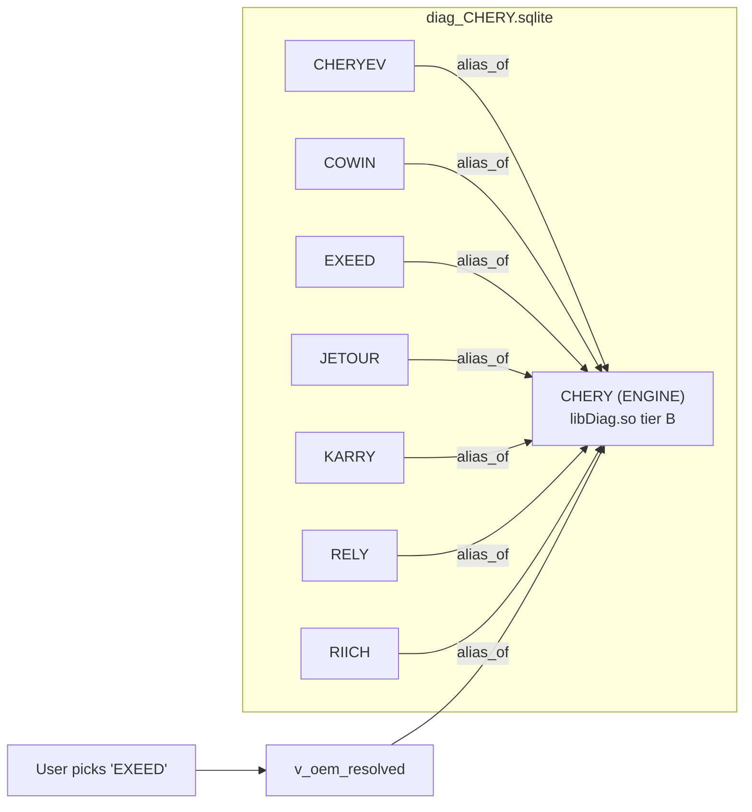
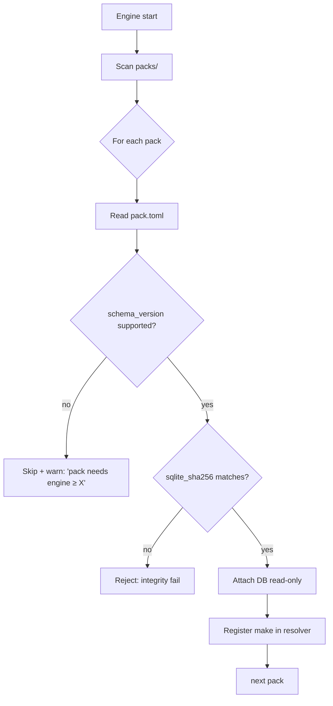

# 06 — OEM Pack Model

Coverage ships as **packs**, independent of the engine. Adding a make, fixing a DTC description, or verifying a routine must never require recompiling or re-releasing the engine. This is what makes the project community-scalable.

## 1. What a pack is

A pack is one make's worth of diagnostic knowledge:

```
packs/
└── chery/
    ├── diag_CHERY.sqlite        # the normalized DB (schema in 02)
    ├── pack.toml                # manifest: identity, versions, integrity
    ├── CHANGELOG.md             # human-readable history
    ├── traces/                  # verification traces (03), PII-stripped
    │   └── oilreset_tiggo7_2023.jsonl
    └── NOTES.md                 # make-specific gotchas for contributors
```

The engine loads packs from a known directory, validates each manifest, checks the DB schema version, and merges them into the working knowledge base at runtime.

## 2. Manifest (`pack.toml`)

```toml
[pack]
make          = "CHERY"
display_name  = "Chery (incl. EXEED, JETOUR, OMODA, Cowin)"
schema_version = "1.0"           # must match engine's supported schema
pack_version  = "2026.10.1"      # calendar-versioned
region        = ["China", "Asia", "AU"]
maintainers   = ["jakka351"]
license       = "see LICENSE"

[integrity]
sqlite_sha256 = "…"              # engine verifies on load
etl_tool_version = "ad200-etl-1.0"

[engines]
# which oem rows are ENGINEs vs ALIASes (mirrors the DB, declared for quick load)
provides = ["CHERY"]
aliases  = ["CHERYEV","COWIN","EXEED","JETOUR","KARRY","RELY","RIICH"]

[capabilities]
# honest summary for the pack browser; computed from DB, declared for discovery
dtc        = 19429
datastream = 11089
routines_catalogued = 91
routines_verified   = 0
```

## 3. The engine / alias mechanism

The `oem` table's `role` + `alias_of` already implement this (see [02 §4](02-data-model.md)). A pack can contain **one engine and many badges**:



This matters because Chinese OEMs sub-brand aggressively (Geely → Geely/Lynk&Co/Geometry/Zeekr; GWM → Haval/Tank/Ora/Poer; SAIC → MG/Maxus/Roewe). One engine's logic drives all its badges; the pack records the badge for UX and resolves to the engine for protocol.

### Cross-pack engine sharing (future)

Some badges are better served by *another pack's* engine (e.g. a joint-venture platform). The `softcode_adr` natural key is stable across packs, so a later schema revision can allow an alias to resolve to an engine in a different pack. Recorded as a roadmap item, not v1.

## 4. Loading & merge semantics



- Packs are attached **read-only**. The engine never writes to a pack at runtime (verification edits go through the contribution flow, offline — [09](09-contributing.md)).
- Make namespaces are isolated (one SQLite per make), so two packs cannot collide. A user can have 3 packs or 30.
- Schema version is a hard gate: an old engine refuses a newer-schema pack with a clear message rather than misreading it.

## 5. Distribution

- **Pack registry**: a simple index (a repo, later optionally a static index file) listing available packs, versions, and integrity hashes. The app can show "updates available".
- **Manual install**: drop a pack folder in `packs/`. No installer, no service.
- **Signing (phase 2)**: packs get detached signatures so users can verify a pack came from a trusted maintainer before attaching. Until then, `sqlite_sha256` in the manifest + registry index is the integrity story.

## 6. Versioning rules

- **Schema version** (`1.0`, `1.1`, …): the DB shape ([02](02-data-model.md)). Engine declares the range it supports. Additive changes bump minor; breaking changes bump major and require a migration note.
- **Pack version** (`2026.10.1`): calendar + patch. Bumps whenever data changes. `CHANGELOG.md` records what moved (e.g. "Tiggo 7 oil-reset routine verified; 1,200 EV BMS datastreams decoded").
- **ETL tool version** (`ad200-etl-1.0`): recorded in `etl_run` and the manifest so a pack's data is traceable to the exact ingestion code that made it ([08](08-ingestion-pipeline.md)).

## 7. Why one-file-per-make (not one big DB)

| One-per-make (chosen) | One monolith (rejected) |
|---|---|
| Ship/update a make independently | Any change re-ships everything |
| A bad pack can't corrupt others | Single point of failure |
| Clear ownership per maintainer | Merge contention |
| User installs only what they need | Forced full download |
| Trivial integrity hashing per pack | Hash churns constantly |

Recorded in [ADR-0001](adr/0001-relational-normalized-db.md).

---

Previous: [05 — Protocol & Services](05-protocol-services.md) · Next: [07 — Safety, Security & Legal](07-safety-security-legal.md)
