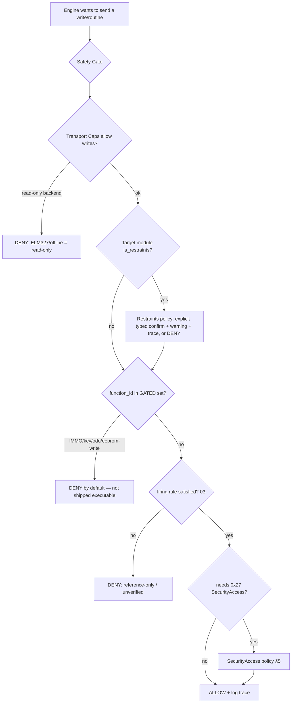

# 07 — Safety, Security & Legal

This is the most important document in the spec. It defines the lines the project will not cross and, more usefully, **how those lines are enforced in the architecture** — not merely promised. A diagnostic tool touches brakes, airbags, immobilisers and odometers; "be careful" is not a design. Gates are.

Read this before contributing anything touching SRS, IMMO, SMART_KEY, PASSWORD_READING, ODOMETER, EEPROM, ECUFLASHING, or SecurityAccess.

## 1. Threat/harm model — what we actually protect against

| Harm | Example | Mitigation in design |
|---|---|---|
| **Physical injury** | Firing/disarming an airbag squib; disabling ABS mid-service | Restraints guard; actuator-test confirmation; session discipline |
| **Vehicle theft enablement** | Key learning, immobiliser defeat, rolling-code attack | IMMO/key functions = metadata only, not executable; no key algorithms shipped |
| **Fraud** | Odometer rollback | Odometer/EEPROM-write routines catalogued for ID, never shipped as executable sequences |
| **Bricking** | A bad flash or coding write | Flashing out of scope v1; writes gated + confirmed + traced |
| **Legal/IP exposure** | Redistributing vendor binaries or lifted crypto | Clean-room policy; binaries never stored; structural slots only |
| **Privacy** | Leaking VIN/owner PII in traces/packs | PII stripping in trace tooling; entitlement PII already redacted at ingest |

## 2. The Safety Gate (single choke point)

Nothing becomes a **write or routine on the bus** without passing one function. It lives at the L3 boundary ([01](01-architecture.md)) so there is exactly one place to audit.

Every DENY is explicit and explained in the UI. Every ALLOW writes a trace. There is no "silent send".

## 3. Restraints guard (`module.is_restraints`)

The schema carries `is_restraints` on `module` precisely so the engine can treat airbag/SRS controllers specially.

- A module with `is_restraints = 1` (SRS/RCM/ACU/OCM/pretensioner/FSRS) **cannot** receive actuator tests (`0x2F`) or routine writes through the normal flow.
- Reading SRS DTCs and live data is fine and encouraged (that's core diagnostics).
- Any write to a restraints module requires: an explicit typed confirmation, an on-screen hazard warning, a capable (non-ELM) backend, and a recorded trace — or it is denied outright. Most restraints *writes* stay out of scope entirely.
- **Contributor rule:** if you add any restraint controller, you **must** set `is_restraints = 1`. A PR adding an SRS-class module without it will be rejected. If in doubt, set it.

## 4. Gated functions (theft/fraud-adjacent)

These `coverage_function` classes are **gated off by default** and are **not shipped as executable routines**, regardless of whether the source data contained them:

`IMMO`, `SMART_KEY`, `PASSWORD_READING`, `RFID`, `ODOMETER`, `ODO_CHECK`, `EEPROM` (write), `ECUCLONING`, and `ECUFLASHING`/`PROGRAMMING`.

What the project **does** do with them:
- **Catalogue them as metadata** so a technician can *see* that a function exists for a make (the coverage matrix in [03](03-provenance-trust-coverage.md) shows them 🔒). This is legitimate: knowing "this car has an immobiliser function class" is information, not a tool.
- **Refuse to execute them** through the Safety Gate. The engine returns a clear "not shipped — theft/fraud-adjacent, out of scope" rather than a confusing failure.

What the project **does not** do, and **will not accept PRs for**:
- Shipping executable immobiliser/key-learning/password-read sequences.
- Shipping odometer-write or EEPROM-write routines that alter recorded mileage.
- Shipping ECU-cloning sequences.

> This is a deliberate scope choice, not timidity. The population this tool is *for* — workshops reading faults and doing scheduled service — is not served by theft/fraud tooling, and shipping it would make the whole project indefensible and get it pulled. Keeping these as gated metadata is the mature position: honest about what exists, unwilling to be the thing that drives it.

Odometer **reading** (displaying the current value as live data) is fine — that's diagnostics. Odometer **writing** is the gated harm.

## 5. SecurityAccess (0x27) — clean-room policy

Many legitimate routines need a `0x27` seed/key unlock first. The project models this honestly without becoming a key-cracking library.

### What the schema stores (and why it's safe)
- `seedkey`: that a lock **exists**, its **shape** (`access_level`, `seed_len`, `key_len`), a **label** for the family (`algo_family`), and where the real tool computed it (`impl_location`). Default provenance `UNVERIFIED`.
- `native_algo`: a **name/slot registry** of algorithms seen in the source. Every row ships `status = PENDING-libStd` / gated — a named placeholder with **no implementation**.

This lets the engine say *"this routine needs SecurityAccess level 03, which we don't ship"* — a clean refusal — instead of failing cryptically. That is the entire purpose of those tables.

### What is forbidden
- **No lifted key algorithms.** Do not paste disassembled or decompiled seed→key code, vendor `.so`/`.dll` logic, or extracted constants that constitute a working key generator.
- **No vendor binaries.** `launch_engine_so` and `file_manifest.path` are **filenames and hashes only**. The `.so`/`.p12`/calibration files themselves never enter the repo (provenance `GATED-LEGAL/IP`).
- **Clean-room only, where legal.** If a SecurityAccess implementation is ever added, it must be an independent clean-room implementation, developed where lawful, kept in a **separate, clearly-licensed, opt-in module** outside the core packs — never bundled, never default. This is recorded in [ADR-0004](adr/0004-safety-gating.md) and is out of scope for v1.

## 6. Legal framing

- **Purpose:** repair, maintenance, diagnosis — protected activity under right-to-repair norms. In Australia, the *Competition and Consumer (Motor Vehicle Service and Repair Information Sharing Scheme) Regulations* (MVIS, in force since 1 July 2022) require manufacturers to make diagnostic/repair information available to independent repairers on fair commercial terms. This project supports that activity; it does not circumvent it.
- **Data vs. code:** the project distributes *diagnostic facts and structure* (a DTC number's meaning, a PID's scaling, a module's address). It does **not** distribute manufacturer software, cryptographic keys, or circumvention devices.
- **Jurisdiction varies:** odometer tampering, immobiliser defeat, and anti-theft circumvention are offences in many jurisdictions. The gated-function policy (§4) exists so the tool is not a circumvention device anywhere.
- **No warranty:** diagnostics can be wrong; vehicles can be damaged by misuse. The tool ships with a clear no-warranty/assumption-of-risk notice, and the provenance model ([03](03-provenance-trust-coverage.md)) means it never overstates confidence.

> This section is engineering guidance, not legal advice. Contributors are responsible for compliance in their own jurisdiction. If a maintainer judges a contribution crosses a line, it's declined — technical merit doesn't override it.

## 7. Contributor red lines (the short version)

A PR is declined, regardless of quality, if it:

1. Ships an executable immobiliser, key-learning, password-read, odometer-write, EEPROM-write, or ECU-clone sequence.
2. Includes a working seed→key algorithm, lifted or otherwise bundled into core.
3. Contains any vendor binary, calibration blob, or signing material.
4. Adds a restraints-class module without `is_restraints = 1`.
5. Marks a routine `verified=1` without an attached, PII-stripped bus trace.
6. Contains VIN/owner PII in data, traces, or examples.

Everything else — DTCs, datastreams, formulas, module maps, safe maintenance routines, VIN *decode rules* (not keys) — is exactly what we want.

---

Previous: [06 — OEM Pack Model](06-oem-pack-model.md) · Next: [08 — Ingestion Pipeline](08-ingestion-pipeline.md)
