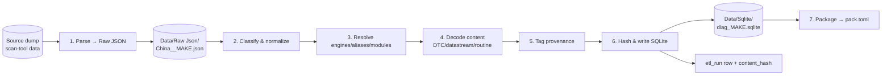

# 08 — Ingestion Pipeline (ETL)

How raw data becomes a shippable pack. The path must be **scripted, reproducible, and hashed** — anyone with the same source should produce the same DB, and every row must trace back to the run that made it. No magic maintainer box.

## 1. Pipeline overview



The repo already contains the output of stages 1 and 6: `Data/Raw Json/China__*.json` (the intermediate) and `Data/Sqlite/diag_*.sqlite` (the product). The ETL code (`OpenDEN.ETL`, Python) is the build target that regenerates the latter from the former reproducibly.

## 2. Raw JSON intermediate (stage 1 output)

Each `Data/Raw Json/China__<MAKE>.json` is a flat capture with these top-level keys:

| key | content |
|---|---|
| `region`, `make` | identity (`"China"`, `"HAFEI"`) |
| `dtcs` | array of `[code, description]` pairs |
| `datastreams` / `formulas` | the scaling expressions (the FML DSL — [05](05-protocol-services.md)) |
| `commands` | raw command fragments (`"01,76"`, `"000030,ff0000,29"`) |
| `routines` | extracted service sequences |
| `strings_sample` / `n_strings` | string-pool sample + total count |
| `files` | source container inventory (→ `file_manifest`) |
| `errors` | parse errors from stage 1, kept for auditability |

Keeping this intermediate in the repo means the normalization stage is independently re-runnable and reviewable without re-accessing the original source.

## 3. Normalization (stages 2–5)

The normalizer turns the flat JSON into the relational model ([02](02-data-model.md)):

1. **Classify** — bucket raw entries into dtc / datastream / routine / module / vin.
2. **Resolve identity** — `softcode_adr` → `oem` row; set `role` (ENGINE/ALIAS/UTIL) and `alias_of`. Module acronyms → the controlled vocabulary.
3. **Decode content** —
   - DTCs: normalize `code` to J2012 form, keep description, set `read_service`/`clear_service` where known.
   - Datastreams: store `formula` verbatim; attempt self-contained decode; leave vendor-interpreter-dependent ones `BLOCKED-CALCSCRIPT`.
   - Routines: frame the UDS service (`sid`/`sub`/`rid_or_did`), store `request_template_hex` **only if** real bytes exist; else NULL + `CalcScriptPendingLibStd`.
4. **Tag provenance** — every row gets the most conservative true `provenance` and (routines) `frame_source` + `verified=0`.
5. **Safety classification** — set `is_restraints` on restraint modules; map functions to `coverage_function`; flag gated classes ([07](07-safety-security-legal.md)).

## 4. Reproducibility & integrity

- **`etl_run`**: one row per pass — `started_utc`, `dump_sync_id` (label/hash of the source snapshot), `tool_version` (e.g. `ad200-etl-1.0`), `notes`. Every content row carries `etl_run_id`.
- **`content_hash`**: on every content table. Stable hash of the semantic payload → dedup within a run and change-detection across runs. A re-run that changes nothing produces identical hashes; a diff of hashes is the changelog.
- **Determinism rule:** the normalizer must be deterministic given the same raw JSON + tool version. No wall-clock-dependent IDs in content (timestamps live only in `etl_run`). Primary keys are assigned in a stable order.

## 5. Re-running the ETL (contributor view)

```bash
# regenerate one make's DB from its raw JSON (illustrative CLI)
opengen-etl build \
  --raw "Data/Raw Json/China__CHERY.json" \
  --out "Data/Sqlite/diag_CHERY.sqlite" \
  --tool-version ad200-etl-1.0 \
  --notes "rebuild + verify oil-reset routine"

# verify the result matches what's committed (CI does this)
opengen-etl verify --db Data/Sqlite/diag_CHERY.sqlite --expect-schema 1.0
```

CI runs `verify` on every PR: schema check, hash consistency, provenance sanity (no `verified=1` without a trace, no restraints module missing `is_restraints`, no gated function shipped executable). A PR that regenerates a DB must show a clean, explainable hash diff.

## 6. Adding content safely

Two legitimate ways to improve a pack:

1. **Re-ingest** better source data → new `etl_run`, new rows, provenance tagged automatically.
2. **Hand-curate / verify** → set `frame_source = HandCurated` or attach a bus trace to promote `verified=1` ([03](03-provenance-trust-coverage.md)). These edits are recorded as their own `etl_run` with `notes` explaining the human step.

Both paths keep the audit trail intact. What you **cannot** do is hand-edit the SQLite and commit it with no `etl_run` story — CI will flag the orphaned rows.

## 7. String-pool decoding (a standing community task)

Many datastream/DTC *text* handles point into the source's string pool (`n_strings` up to ~90k per make), much of it `BLOCKED-CALCSCRIPT`/`NOW-STRUCTURE-ONLY`. Decoding that pool is a high-value, low-risk contribution: it turns handles like `FE00000715D6` into real localized labels. It's pure data work, no bus access, and directly lights up coverage. See [09](09-contributing.md) for how to claim and submit this work.

---

Previous: [07 — Safety, Security & Legal](07-safety-security-legal.md) · Next: [09 — Contributing](09-contributing.md)
