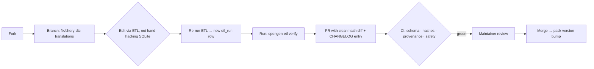

# 09 — Contributing

This project scales on contributions, and most of them need **no C# and no engine knowledge** — the data/engine split ([01](01-architecture.md), [06](06-oem-pack-model.md)) means you can add enormous value by working on packs alone. This document is the on-ramp.

## 1. Ways to contribute (easiest → deepest)

| Contribution | Skill needed | Risk | Impact |
|---|---|---|---|
| Fix/translate DTC descriptions | none / language | none | high (readability) |
| Decode string-pool handles → labels | data patience | none | high (lights up datastreams) |
| Decode a datastream formula | bit-twiddling | none | high |
| Map module CAN IDs (`tx_id`/`rx_id`) | a car + interface | low | high (enables targeted scans) |
| **Verify** a catalogued routine | a car + capable interface | medium | high (turns 🟡→✅) |
| Add a new make pack | ETL + a source | medium | very high |
| Engine / transport code | C# / .NET | — | core |
| New transport backend (DoIP, etc.) | C# + protocol | — | core |

The quickest wins are pure data: descriptions, string-pool decoding, formulas. No hardware required — you can do them from the couch against the shipped DBs.

## 2. Repo layout (target)

```
opium-den-oem/
├── Data/
│   ├── Raw Json/            # ETL stage-1 intermediates (per make)
│   └── Sqlite/              # shipped normalized DBs (per make)
├── src/
│   ├── PassThru/            # J2534 + ELM327 transport (C#) — exists
│   ├── OpenDEN.Transport/   # HAL over PassThru (ITransport)
│   ├── OpenDEN.Core/        # UDS/KWP client, formula engine, routine exec, safety gate
│   ├── OpenDEN.Data/        # DB access + pack loading
│   └── OpenDEN.App/         # reference GUI + CLI
├── etl/                     # OpenDEN.ETL (Python)
├── packs/                   # distributable packs (DB + manifest + traces)
└── docs/                    # this spec
```

## 3. Data contribution flow



**Golden rule:** edit the data through the ETL so provenance and `etl_run` stay honest ([08](08-ingestion-pipeline.md)). Don't hand-edit the SQLite and commit a mystery blob — CI flags orphaned rows.

## 4. Verifying a routine (the high-value, medium-risk one)

This is how a catalogued routine (🟡 `verified=0`) becomes a trusted ✅.

1. Pick a routine that is **not** a gated/restraints function ([07](07-safety-security-legal.md)). Good first targets: `OILRESET`, `EPB` (bleed/service), `THROTTLE` relearn, `BMS` register, `STEERING` angle reset.
2. Connect a **capable** interface (J2534 or SocketCAN — not an ELM327) to a real vehicle you own or have permission to work on.
3. Run it through the engine with tracing on ([04](04-transport-hal.md)).
4. The engine captures the request + response trace. **Strip PII** (the tooling removes VIN/owner data automatically; check it).
5. Submit the routine promotion + the trace file. The maintainer reviews that the service is sane, the response is a genuine positive, and the function is safe.
6. On merge: `verified=1`, trace hash attached, `frame_source` may promote to `VehicleTested`, UI shows "tested on <vehicle/VIN-pattern>".

**Never** set `verified=1` without a trace. **Never** verify a gated or restraints function through this flow.

## 5. Adding a new make

1. Obtain a source you have the right to use. Produce the stage-1 `China__<MAKE>.json` ([08 §2](08-ingestion-pipeline.md)).
2. Run `opengen-etl build` → `diag_<MAKE>.sqlite`.
3. Write `packs/<make>/pack.toml` ([06 §2](06-oem-pack-model.md)).
4. Verify, then PR. Expect questions about source provenance — be ready to explain where the data came from and that it contains no vendor binaries/keys/PII.

## 6. Coding standards (engine)

- **.NET / C#** for `OpenDEN.*`; follow the existing `/src/PassThru` style (explicit types, `J2534Err`-style result enums over exceptions on the hot path).
- The **Safety Gate is sacred**: any code path that reaches the bus as a write/routine must go through it. PRs that bypass it are rejected on principle, not negotiated.
- **Transports implement `ITransport` fully**, including honest `Capabilities`. Don't advertise `MultiFrameIsoTp` you can't deliver.
- **The formula evaluator is a sandbox** ([05 §3.2](05-protocol-services.md)): pure, bounded, total, no host access. It parses untrusted data.
- **Tests**: new services/formulas ship with tests against recorded traces on `vcan0`. CI runs them headless.

## 7. Review bar

A maintainer merges when:

- [ ] CI is green (schema, hashes, provenance sanity, safety checks, tests).
- [ ] Provenance is conservative and defensible ([03](03-provenance-trust-coverage.md)).
- [ ] No red-line violation ([07 §7](07-safety-security-legal.md)): no shipped immo/key/odo-write/eeprom-write/clone sequences, no keys, no binaries, no PII, restraints flagged.
- [ ] `CHANGELOG.md` + pack/schema version bumped as appropriate.
- [ ] The change is *honest* — it doesn't make the DB claim more than it's proven.

## 8. Good first issues (suggested)

- Translate the Chinese-sourced DTC descriptions that came through rough (`diag_CHANGAN` has 25k DTCs — plenty).
- Decode the enumerated string-pool handles for one module family.
- Map `tx_id`/`rx_id` for the common modules (ECM `7E0/7E8`, TCM `7E1/7E9`, …) on a make you have access to.
- Verify `OILRESET` on any one vehicle and submit the trace — be the first green routine.
- Write a datastream formula decoder for the simplest `NOW-STRUCTURE-ONLY` rows.

---

Previous: [08 — Ingestion Pipeline](08-ingestion-pipeline.md) · Next: [10 — Roadmap](10-roadmap.md)
